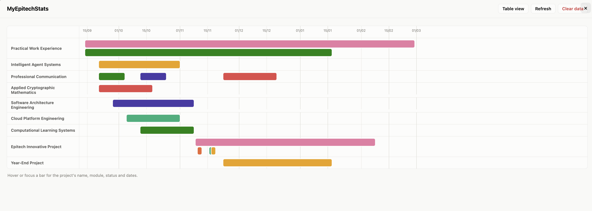

# MyEpitechStats

Extension Chrome vibecodeslop pour my epitech fais en 1 prompt
pour voir la timeline des projets
(pcq pourquoi je vais coder une vraie extension pour un intra mal vibecodé et aussi pq jferais un vrai readme à la main mdr bref)

Ce n'est pas un outil officiel d'Epitech, c'est un projet personnel.

ça ressemble à ça

  

## Installation (5 minutes, sans rien installer d'autre)

Marche sur **Chrome** (et les navigateurs basés dessus : Edge, Brave, ...)
et sur **Firefox**. Aucune installation de Node, npm ou autre n'est
nécessaire : tout est déjà compilé et prêt à l'emploi dans le projet.

### 1. Télécharger le projet

- Va sur la page GitHub du projet.
- Clique sur le bouton vert **Code**, puis **Download ZIP**.
- Dézippe le fichier téléchargé (double-clique dessus, ou clic droit →
  "Extraire" / "Décompresser").

### 2. Charger l'extension

#### Sur Chrome

- Va à l'adresse : `chrome://extensions`
- En haut à droite, active l'interrupteur **Mode développeur**.
- Clique sur **Charger l'extension non empaquetée** (*Load unpacked*).
- Sélectionne le dossier **`dist`** qui se trouve à l'intérieur du dossier
  que tu as dézippé (pas le dossier principal, bien celui qui s'appelle
  `dist`).
- L'extension **MyEpitechStats** apparaît dans la liste, c'est fait.

#### Sur Firefox

- Va à l'adresse : `about:debugging#/runtime/this-firefox`
- Clique sur **Load Temporary Add-on...** (*Charger un module
  complémentaire temporaire*).
- Sélectionne le fichier **`manifest.json`** qui se trouve dans le dossier
  **`dist-firefox`** (à l'intérieur du dossier dézippé).
- L'extension **MyEpitechStats** apparaît dans la liste, c'est fait.

  ⚠️ Sur Firefox, ce chargement "temporaire" ne survit pas à un redémarrage
  du navigateur (il faudra refaire cette étape à chaque redémarrage de
  Firefox) — c'est une limite de Firefox, pas de l'extension. Pour une
  installation permanente, il faut passer par addons.mozilla.org (voir
  [DEVELOPMENT.md](DEVELOPMENT.md)).

## Utilisation

1. Va sur [my.epitech.eu](https://my.epitech.eu).
2. Dans le menu de gauche, un nouvel onglet **Timeline** apparaît juste
   après "Projects".
3. Clique dessus : ta timeline s'affiche par-dessus la page.
4. Survole une barre colorée avec la souris pour voir le nom du projet, son
   module, son statut et ses dates.
5. Bouton **Table view** pour voir la même chose sous forme de tableau.

Plus tu navigues sur les pages "Projects" (Upcoming / Current / Past),
plus la timeline se remplit automatiquement — l'extension retient tout ce
qu'elle a déjà vu.

### Seulement tes units

La timeline n'affiche que les projets des units auxquelles tu es inscrit.
Pour ça, ouvre une fois la page **Units** : l'extension lit les boutons
*Register* / *Unregister* et retient lesquelles sont les tiennes. Tant que
tu n'as pas visité cette page, tous les projets sont affichés. Si tu
t'inscris ou te désinscris plus tard, repasse sur la page Units pour mettre
à jour la liste.

### Les petits plus sur my.epitech.eu

- **Test results** : un pourcentage de réussite s'ajoute à côté de
  "X/Y TESTS".
- **Evaluations** : ouvre un **View report**, le total des notes
  (ex. `56/58 · 97%`) s'affiche à côté du titre, puis sur la carte de
  l'évaluation dans la liste. Une évaluation n'a sa note sur la liste
  qu'après avoir ouvert son rapport une fois.
- **Menu burger** : le petit bouton rond ☰ sur le bord de la barre
  latérale la réduit à ses icônes (et la rouvre). Ton choix est retenu.

## Mes données sont-elles envoyées quelque part ?

Non. Tout reste dans le stockage local de ton navigateur (Chrome ou
Firefox). Rien n'est envoyé sur internet. Voir [PRIVACY.md](PRIVACY.md)
pour le détail.

## Mettre à jour l'extension

Quand une nouvelle version est disponible sur GitHub : retélécharge le ZIP,
dézippe-le, puis :

- **Chrome** : sur `chrome://extensions`, clique sur l'icône de
  rechargement (🔄) de l'extension MyEpitechStats — ou supprime l'ancienne
  et recharge le nouveau dossier `dist` avec **Charger l'extension non
  empaquetée**.
- **Firefox** : refais l'étape **Load Temporary Add-on...** sur
  `about:debugging#/runtime/this-firefox` avec le nouveau
  `dist-firefox/manifest.json` (ou clique sur **Reload** à côté de
  l'extension si elle apparaît déjà dans la liste).

## Je veux modifier le code / contribuer

Voir [DEVELOPMENT.md](DEVELOPMENT.md).
